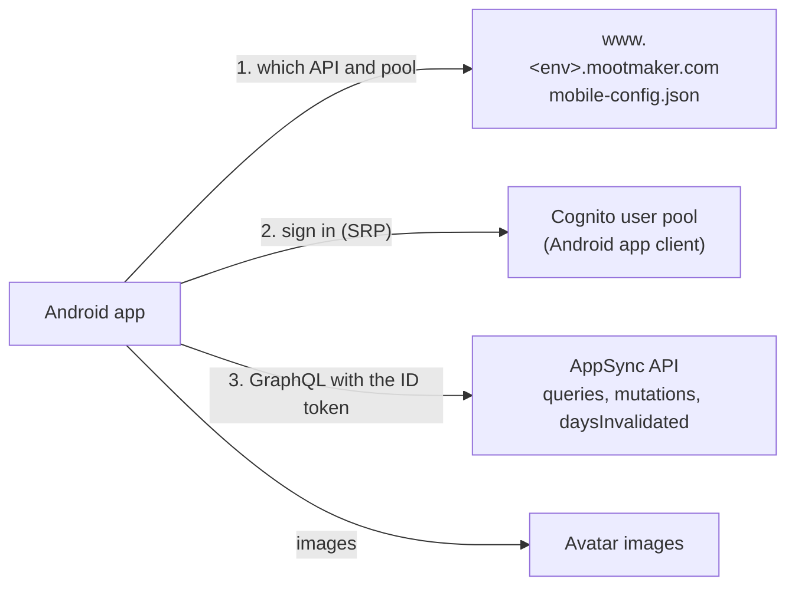
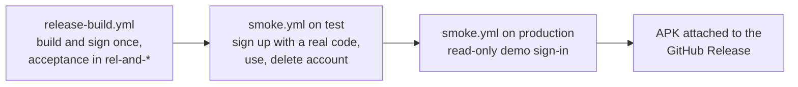

# mootmaker-android

The native Android app: a second client of the same API, accounts and data as the web app. Everything a
user can do on the web, they can do here. That covers signing up, signing in and resetting a password;
the agenda, room availability, person calendars and meeting details; adding, editing, cancelling and
responding to meetings, with live updates; settings, avatars and deleting the account; and, for admins,
managing rooms and people.

Each release attaches the signed APK to its
[mootmaker-release GitHub Release](https://github.com/geoffweatherall/mootmaker-release/releases/latest).
The app is not in an app store; it is installed from that APK.



How it is built inside: **[docs/architecture.md](docs/architecture.md)**. How it is tested:
**[testing-strategy.md](testing-strategy.md)**. How the whole system fits together: the hub's
[system overview](https://github.com/geoffweatherall/mootmaker/blob/main/docs/overview/system.md).

## Layout

| Path | What |
|---|---|
| `app/` | Compose screens, navigation, ViewModels, the `AppContainer` |
| `data/` | Config, Cognito (SRP), encrypted token storage, the GraphQL operations, `WorkspaceStore`, the live channel, and the pure rules screens use |
| `testing/` | `FakeBackend`, which plays config, Cognito and GraphQL inside OkHttp for JVM tests |
| `app/src/test/` | ViewModel, Robolectric flow and screen tests, and screenshot tests (PNGs in `app/src/test/screenshots/`) |
| `app/src/androidTest/` | Emulator tests; `acceptance/` holds the acceptance suite, by use case |
| `smoke/` | Maestro flows run against `test` and production during a release |
| `email-helper/` | A small Node server, started on the CI runner, that hands real Cognito codes from mootmaker-email-testing's queue to the emulator and to Maestro |
| `scripts/cloud-setup.sh` | Installs the Android SDK in a cloud session and warms Gradle |
| `.github/workflows/` | `pr-checks.yml`, `acceptance.yml`, `release-build.yml`, `smoke.yml` (see below) |

## Building

You need JDK 21 and an Android SDK (`ANDROID_HOME`). `scripts/cloud-setup.sh` installs one.

```bash
./gradlew :app:assembleDebug :app:lintDebug :data:testDebugUnitTest :app:verifyRoborazziDebug
```

That is what pr-checks runs; `verifyRoborazziDebug` runs all of `app`'s JVM tests, not only the screenshots.

- **The GraphQL schema is downloaded at build time** from the `@mootmaker/schema` npm package, at the
  version pinned in `data/build.gradle.kts`. To use a new API field, publish the schema from mootmaker-api
  first, then raise the pin.
- **Screenshots are committed and verified.** After an intended visual change, re-record them with
  `./gradlew :app:recordRoborazziDebug` and commit the PNGs.
- **Emulator tests run only in GitHub Actions.**

## Running it against an environment

Install a debug build (`./gradlew :app:installDebug`) or a release APK. The app starts against
production. To use another environment, open About, tap the version seven times and enter the
environment's name, such as `test` or `claude-261012-ab12`. That environment's web app must be deployed,
because the app reads its `mobile-config.json` from the environment's web host.

## Pull requests

| Workflow | When | What |
|---|---|---|
| `pr-checks.yml` | Every pull request | Build, lint, unit, Robolectric and screenshot tests; an API 34 emulator job for instrumented tests and a read-only demo sign-in |
| `acceptance.yml` | A pull request labelled `run-acceptance` | Runs `release-build.yml` with a throwaway signing key: the full acceptance suite in a new `and-acc-*` environment, torn down afterwards |

Acceptance needs AWS, and AWS trusts this repository's GitHub token only for a `pull_request` event, so
add the label to a pull request rather than running the workflow by hand.

## Releases

The app is one of the four components of a release, built by mootmaker-release's `release.yml`:



- **One APK per release**, signed once with the release key held by mootmaker-release, and tested and
  published as the same bytes. The release tag sets its version.
- **Without the signing secret, a release skips the Android stages** rather than failing, so the backend
  still ships.
- **Installed apps are not updated when the API deploys.** mootmaker-api's pull request checks refuse a
  breaking schema change unless it is labelled `allow-breaking-schema-change`, because it would break
  phones already in use.

If a release's Android stage fails, see the hub's
[failed release runbook](https://github.com/geoffweatherall/mootmaker/blob/main/docs/runbooks/failed-release.md).
If the app itself misbehaves, see
[Android app problems](https://github.com/geoffweatherall/mootmaker/blob/main/docs/runbooks/android-app-problems.md).

Read [AGENTS.md](AGENTS.md) before doing work here.
