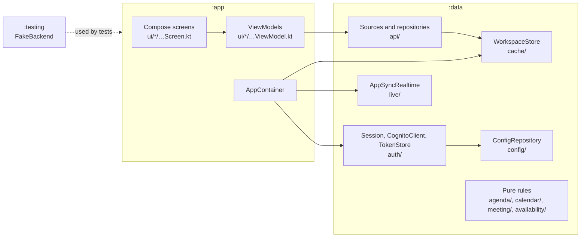
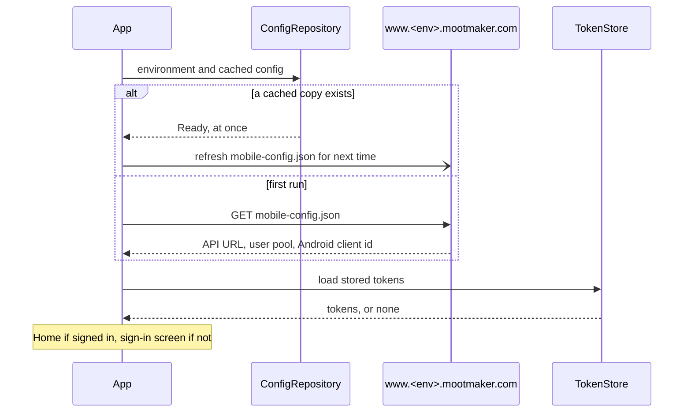
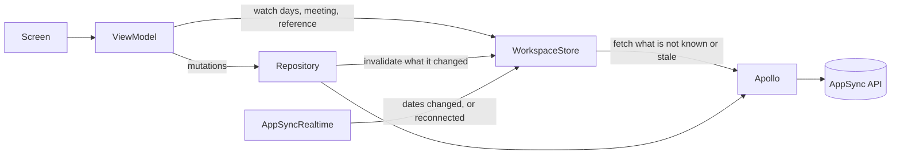
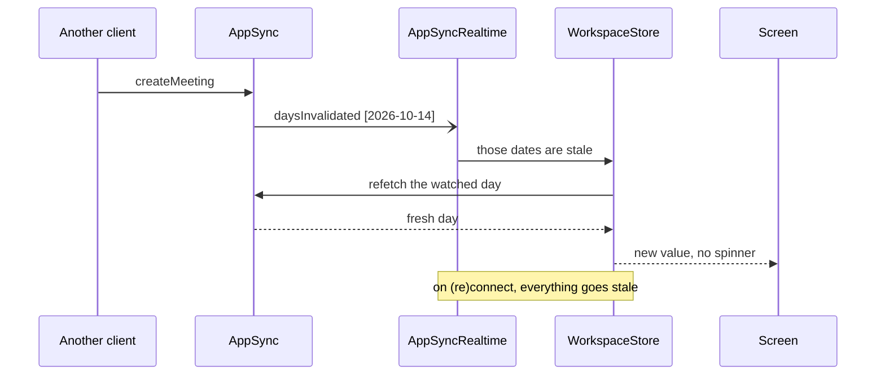

# How the Android app is built

The app is a second client of the same GraphQL API as the web app. It uses the same Cognito user pool
(through its own app client) and the same live-update channel, and it follows the same rules. This page
covers what is specific to Android. For the parts every client shares, see the hub's
[system overview](https://github.com/geoffweatherall/mootmaker/blob/main/docs/overview/system.md).

## Stack

Kotlin, Jetpack Compose with Material 3, Navigation Compose, Apollo Kotlin (queries and mutations only),
OkHttp, Coil for avatars, and DataStore for small persisted values. There is no DI framework: the
`AppContainer` wires a dozen long-lived objects by hand. Minimum SDK 26, target SDK 35.

## Modules

- **`:app`** holds the screens, their ViewModels, navigation (`ui/MootmakerApp.kt`) and the `AppContainer`.
- **`:data`** holds everything that talks to the outside world or can be tested without Android: config,
  authentication, the GraphQL operations (`src/main/graphql/`), the store, the live channel, and the pure
  rules screens use. These include agenda grouping, the calendar week, the add-meeting form's rules and the
  availability timeline.
- **`:testing`** holds `FakeBackend`, an OkHttp interceptor that plays the config host, Cognito and the
  GraphQL API, so whole-app tests run on the JVM.

## Starting up

- **Configuration comes from the web host**, not from the build. The web app's deploy writes
  `mobile-config.json` beside the site, so one APK works against any environment. The keys are
  `GRAPHQL_API_URL`, `COGNITO_USER_POOL_ID` and `COGNITO_ANDROID_CLIENT_ID`, and optionally
  `DEMO_USER_EMAIL` and `DEMO_USER_PASSWORD`. Unknown keys are ignored. The last good copy is cached, so
  a cold start does not wait on the network.
- **The environment is production unless changed.** Tapping the version on the About screen seven times
  lets you enter another environment's name. Switching signs out, because tokens belong to one user pool.

## Signing in and tokens

- **Cognito directly, over HTTPS, with SRP** (`auth/Srp.kt`, `auth/CognitoClient.kt`). There is no AWS
  SDK. Sign-up, the emailed code, password reset and sign-out (which revokes the refresh token) are calls
  to the same Cognito API.
- **Tokens are stored encrypted.** `TokenStore` encrypts them with AES-GCM under a key held in the Android
  Keystore, which never leaves it. A copy of the app's data directory cannot reveal them. Tokens that
  cannot be decrypted, for example after a restore to a new phone, count as signed out.
- **The ID token is the API credential.** `Session.idToken()` refreshes it when it is within five minutes
  of expiry. If Cognito refuses the refresh (the pool was recreated, or the refresh token expired), the app
  signs out cleanly and says the session expired. It does not loop or crash.
- **Navigation follows the session.** Signing in replaces the sign-in screen with Home. Signing out clears
  the back stack, so Back can never return to a signed-in screen.

Shared rules for accounts, roles and tokens are in the hub's
[identity and access overview](https://github.com/geoffweatherall/mootmaker/blob/main/docs/overview/identity-and-access.md).

## Screens

| Route | Screen | Who |
|---|---|---|
| `signin`, `signup`, `forgot-password` | Sign in (including the demo sign-in), create an account, reset a password | Signed out |
| `home` | Meetings needing your response, today's and tomorrow's agenda, shortcuts | Signed in |
| `availability/{date}` | Each room's day | Signed in |
| `calendar/{personId}` | One person's working week | Signed in |
| `meeting/{id}` | A meeting, with response buttons, Share, Edit and Cancel | Signed in |
| `meetings/add/{date}`, `meeting/{id}/edit` | The meeting form, with the quarter-hour time dial | Signed in |
| `settings` | Name, date and time format, avatar, delete account | Signed in |
| `admin/rooms`, `admin/persons` | Room and people management | Admins |
| `about` | Version, and the environment switch after seven taps | Anyone |

Share sends the meeting's web address (`<site>/meetings/<id>`, for example
`https://www.mootmaker.com/meetings/<id>`). The app does not open those links itself.

## Data and the cache

- **One in-memory store** (`cache/WorkspaceStore.kt`) holds what the app has seen: the reference data (you,
  people, rooms, the bookable window), days, and meetings looked up by id. Home, Room Availability,
  Calendar and Meeting Details all draw from it, so going back to something already seen shows it at once.
- **Screens watch what they show.** A watch fetches anything not yet known. While it lasts, an invalidation
  of what it shows is refetched at once. Something invalidated that nobody watches becomes stale and is
  refetched when next watched.
- **Spinners.** The full spinner shows only for something never held. A refetch keeps the old value on
  screen under a slim bar. Only a known, empty day may read as "no meetings".
- **Late responses.** A response in flight when its date was invalidated is stored but stays stale, and
  is fetched again. Signing out empties the store, and a response issued before an identity change is
  dropped rather than shown to the next account.
- **Writes are mutations through the repositories.** A refused write comes back as data (the API's
  `errors` codes, worded in the screen), not as an exception. After a write, the repository invalidates what
  it changed.
- **Why not Apollo's normalized cache:** see
  [the android-cache design](https://github.com/geoffweatherall/mootmaker/blob/main/designs/archive/android-cache.md).

### Live updates

`AppSyncRealtime` is a small hand-written client for AppSync's realtime protocol. Apollo's subscription
transports speak `graphql-transport-ws`, which AppSync does not. It subscribes to `daysInvalidated`
while the app is signed in **and in the foreground**. Leaving either closes the socket, because Android
freezes background sockets anyway, so correctness never depends on one surviving.

- A dropped socket reconnects with exponential backoff and a fresh token.
- A reconnect marks everything stale, because anything published while disconnected was missed.
- Returning to the app refetches only what is shown and more than five minutes old.

The full rules, and how the web app does the same, are in the hub's
[concurrent updates overview](https://github.com/geoffweatherall/mootmaker/blob/main/docs/overview/concurrent-updates.md).

## Rules every screen follows

**Errors.** Use the shared components in `app/src/main/kotlin/com/mootmaker/app/ui/Errors.kt`; never draw
a red `Text`.
1. **Nothing to show yet** (the first load failed): `LoadFailed(message, onRetry)` fills the screen.
2. **Any other error not about one field** (a failed refresh, a refused or failed save, response, cancel
   or admin change): `ErrorBanner(messages, onDismiss, onRetry)`.
   - It sits above the scrolling content, inside the Scaffold, as
     `Column { ErrorBanner(...); content with Modifier.weight(1f) }`. It is never inside the scroll, so it
     cannot scroll out of view.
   - Every message appears in full, one per line. The banner grows to a third of the screen and then
     scrolls within itself.
   - It is dismissible, and offers **Try again** for a failed refresh. It is a polite live region, so
     TalkBack announces it.
   - A screen with several sections (Settings) still has one banner, with each message prefixed by its
     section's title.
3. **Errors inside a dialog stay in the dialog.**
4. **A field's own problem stays on the field** (`isError` and `supportingText`). This covers what the app
   checks before calling the API.

**Validation.** The API enforces every rule. The app only prevents what it cheaply can, as the web app
does: the time dial offers quarter hours only, and people and rooms are picked from lists.

**Times.** Times from the API are local date-times with no zone (`2026-10-07T09:00:00`). Parse them as
`LocalDateTime`, never `Instant` or `ZonedDateTime`. Each viewer's own date and time format applies
everywhere. Rules for the whole system:
[time and time zones](https://github.com/geoffweatherall/mootmaker/blob/main/docs/overview/time-and-time-zones.md).

**Accessibility.** Every icon-only control has a content description. Tests find elements by text and
content description, the same labels TalkBack reads. Text wraps rather than clips at Android's largest
font size.

**Look.** Material 3, following the system's light or dark setting. The colours and room-colour slots
match the web app's brand tokens (`ui/theme/Theme.kt`).

## Versions and signing

A release build gets its version from the release tag (`-PmootmakerVersion=6.2.0`). Its `versionCode` is
major × 1,000,000 + minor × 1,000 + patch, so it always increases. Local and pull-request builds are
`0.0.0`. The release key is a secret of **mootmaker-release**, not of this repository:
`release-build.yml` receives it from its caller, writes it outside the workspace for the build and
deletes it when the job ends. A pull request labelled `run-acceptance` builds with a throwaway key
generated in the job, so the real key never leaves mootmaker-release. Debug builds use the standard debug key. How the APK is built, tested and published is
in [README.md](../README.md#releases).
